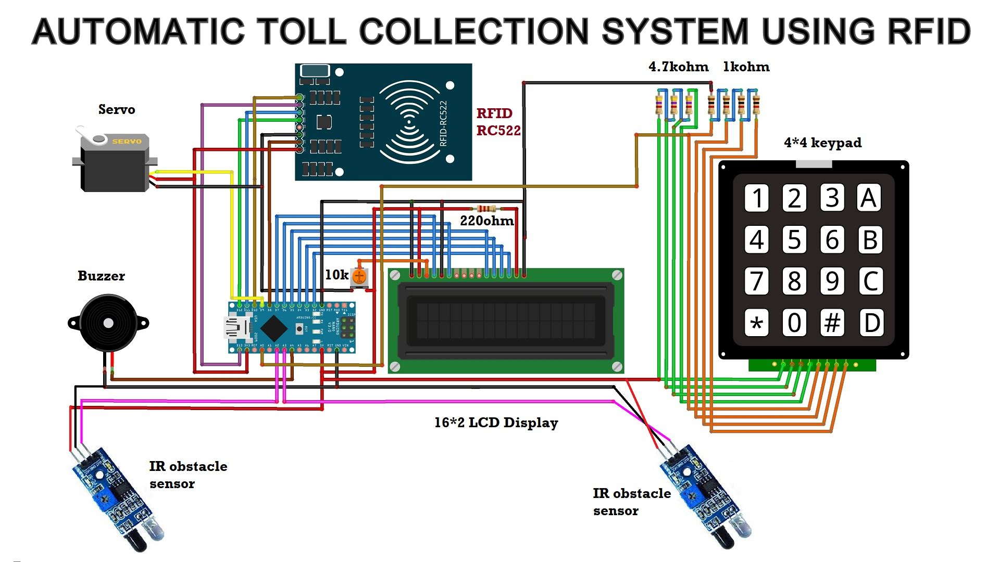

# Automated Toll Collection System Using RFID Tag

A small model of an RFID toll gate built on an Arduino Nano. Each vehicle has a passive RFID tag with a prepaid balance. When a vehicle comes to the gate it scans its tag, the toll is deducted, and the barrier opens. Balance can be recharged from a keypad at the booth.

I made this as a college project for my B.Tech in Electronics and Telecommunication. The report and slides are in `docs/`.



## Hardware

- Arduino Nano
- MFRC522 (RC522) RFID reader and tags
- 16x2 LCD with a 10k pot for contrast and 220 ohm for the backlight
- 4x4 membrane keypad, read on one analog pin through a resistor ladder (4.7k and 1k)
- Micro servo for the barrier
- 2 IR obstacle sensors
- Buzzer

## Wiring

| Part | Arduino pin |
| --- | --- |
| LCD RS, EN, D4, D5, D6, D7 | D7, D6, D5, D4, D3, D2 |
| RC522 SDA (SS) | D10 |
| RC522 SCK, MOSI, MISO | D13, D11, D12 |
| RC522 RST | D8 |
| RC522 VCC | 3.3V |
| Servo signal | D9 |
| Keypad (resistor ladder output) | A0 |
| IR sensor 1, before the gate | A2 |
| IR sensor 2, at the gate | A3 |
| Buzzer | A4 |

The IR sensors are active low (output goes LOW when a vehicle is in front).

## How it works

1. The barrier starts open and the LCD shows "Welcome".
2. When IR sensor 1 sees a vehicle, the barrier closes and the LCD asks for the card.
3. The tag is scanned:
   - unknown tag: buzzer and "Access denied"
   - registered tag with at least Rs 500: Rs 500 is deducted and the remaining balance is shown
   - registered tag with less than Rs 500: "Please Recharge", the barrier stays closed
4. After paying, when the vehicle reaches IR sensor 2, the barrier opens and the LCD shows "Have a safe journey".

If a card is scanned when no vehicle is waiting, or after it has already paid, it only shows the balance and nothing is deducted.

### Recharge

1. Scan the card that needs a recharge.
2. Press `A` on the keypad to go into recharge mode.
3. Type the amount (up to 6 digits).
4. Press `D` to add it to the card, or `C` to cancel.

The recharge always goes to the last card that was scanned.

## Setup

1. Install the Arduino IDE (1.8.x).
2. Install the libraries:
   - MFRC522 by miguelbalboa, from the Library Manager
   - [OnewireKeypad](https://github.com/AndrewMascolo/OnewireKeypad) by Andrew Mascolo, download the zip and add it with Sketch > Include Library > Add .ZIP Library
   - LiquidCrystal, Servo and SPI come with the IDE
3. Open `rfid_toll_system/rfid_toll_system.ino`, select Arduino Nano and upload.

### Adding your own tags

The UIDs in the sketch are the two tags I had. To use other tags, open the Serial Monitor at 9600 baud and scan a tag, its UID gets printed like `84 E6 E0 1F`. Put it in `cardUid`, set a starting balance in `balance` and update `NUM_CARDS`.

The toll amount is `TOLL` at the top of the sketch.

## Limitations

- Balances are kept in RAM, so they go back to the starting values when the board resets.
- Card UIDs and balances are hard coded, there is no database or server.
- Only one toll amount for every vehicle.

## Files

```
rfid_toll_system/rfid_toll_system.ino   Arduino sketch
docs/circuit_diagram.jpg                circuit diagram
docs/presentation.pptx                  project slides
docs/report_1.pdf, docs/report_2.pdf    project reports
```
